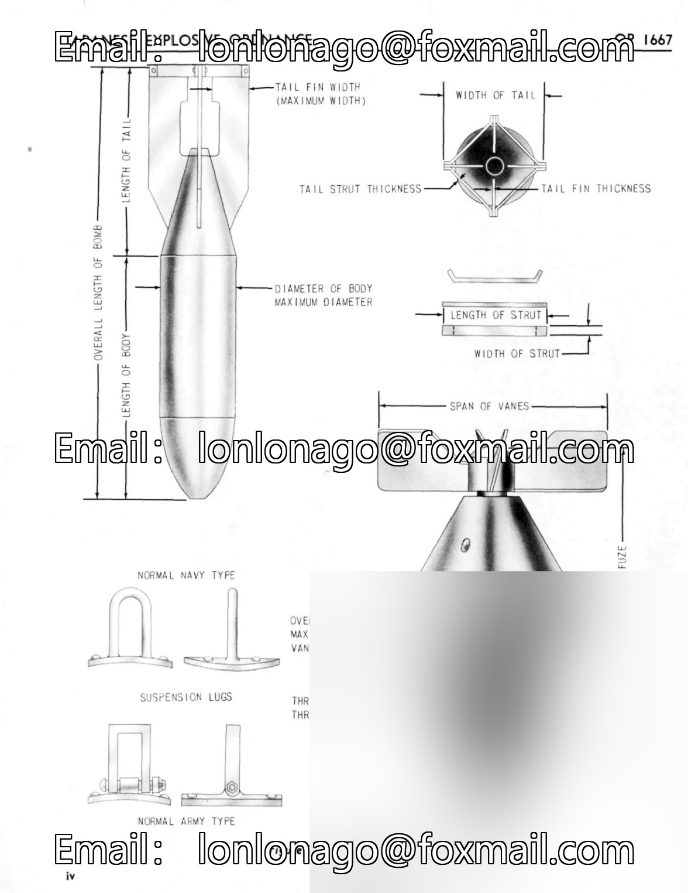
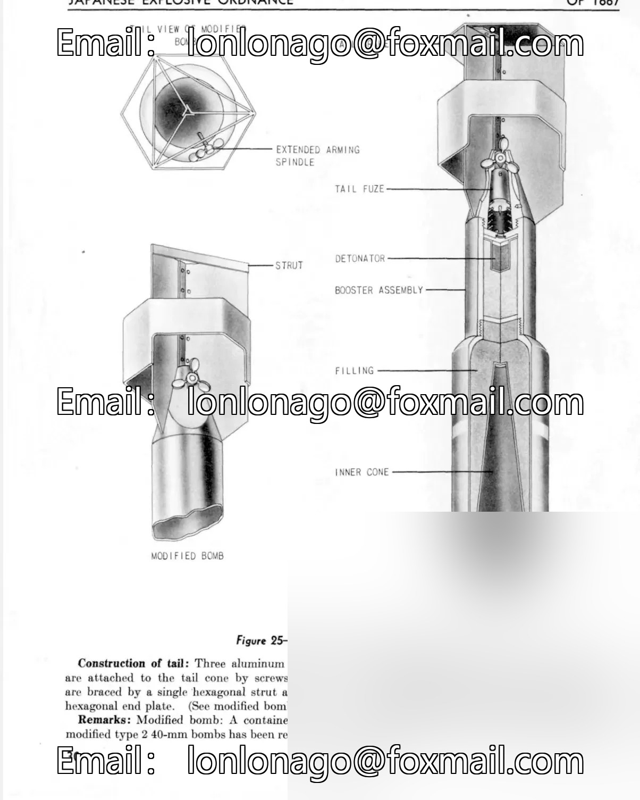
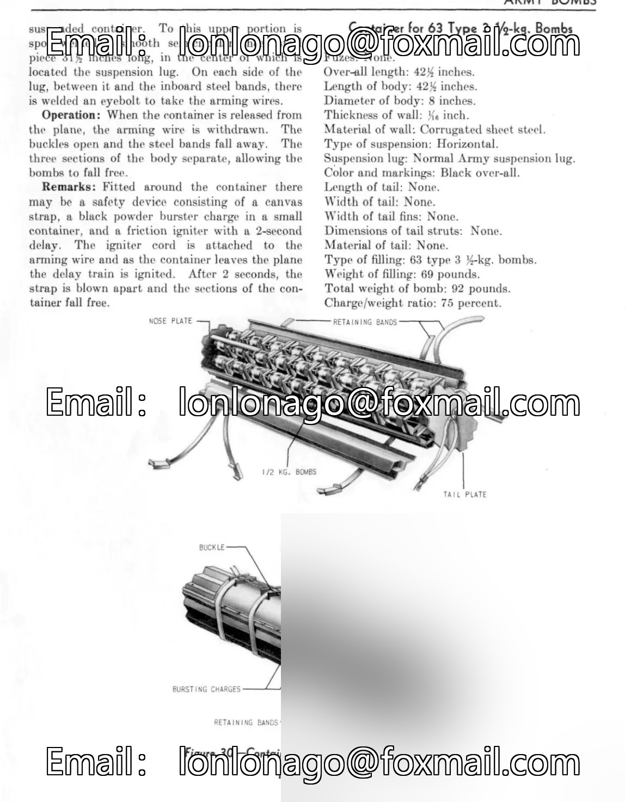
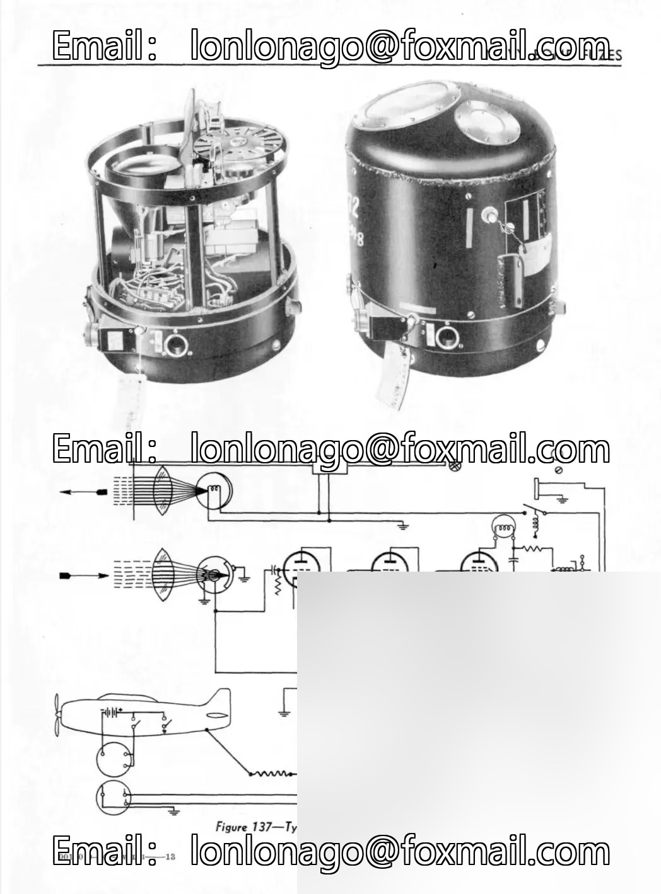
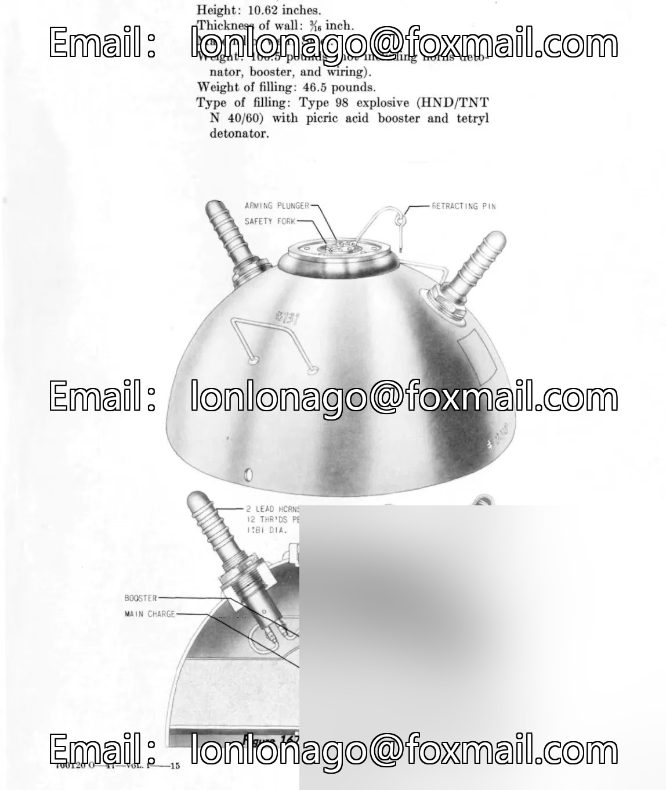
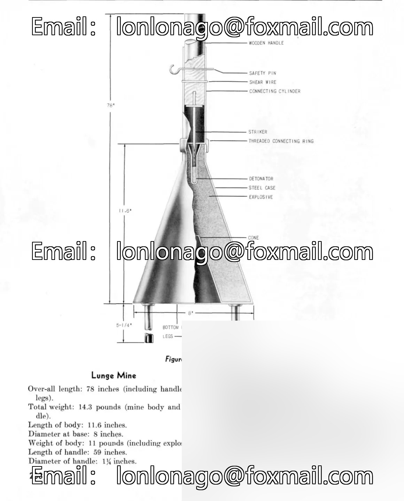
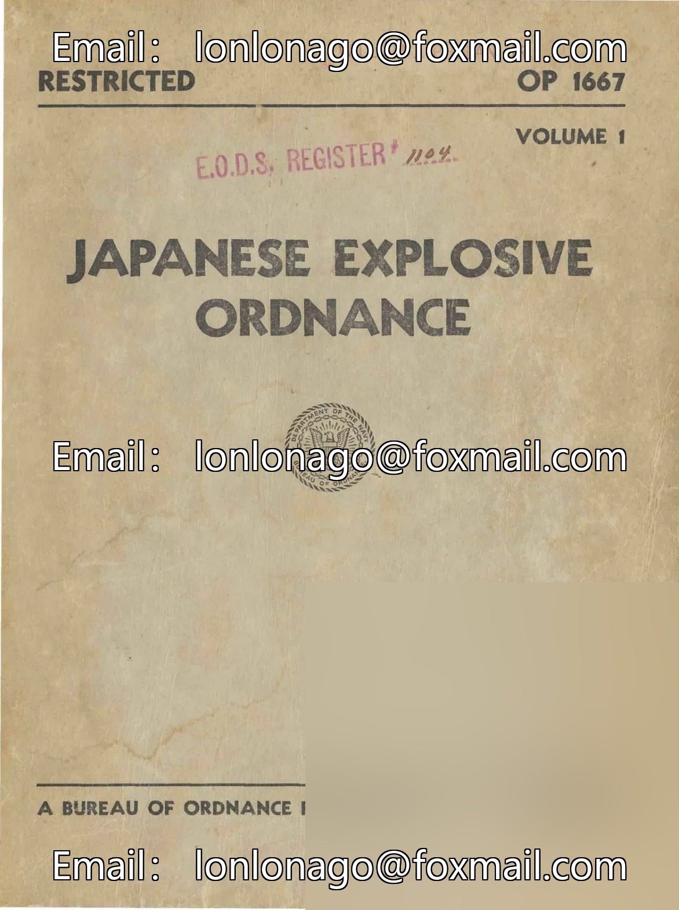

# Materials of Second World War Japanese military explosive materials, three volumes.

## Body

Materials of Second World War Japanese military explosive materials, three volumes.
Content includes Japanese military bombs Aeroball, Detailed structural diagrams of rockets and other weapons Parameters Illustration, etc. Materials are authoritative Suitable for military enthusiasts Historical research Tactical analysis reference.
The materials are electronic files, send the download links after capturing them, .

The material includes detailed structure, parameters and schematics for Japanese military bombs, aerospaces and rockets, with an authoritative format suitable for military enthusiasts, historical research and tactical analysis.

<!-- AI_ENRICHED -->

## Images

## Payment

Here is a pay link on Stripe ( https://buy.stripe.com/3cs8yP7sY87d0vu9AB ). Please contact me lonlonago@foxmail.com after funding $89, and I will send you a complete data files , thank you!

